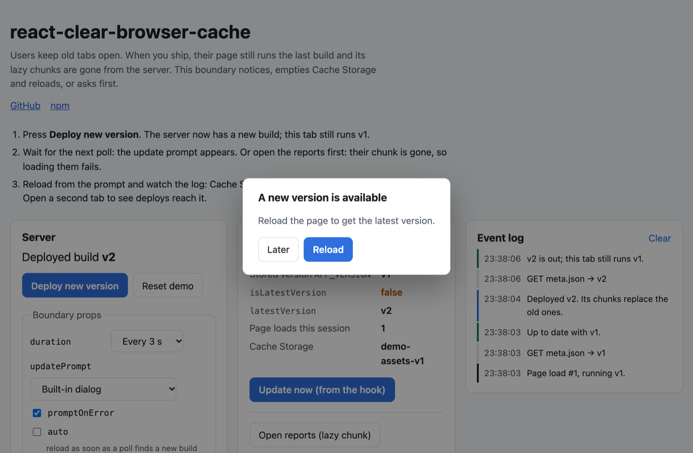
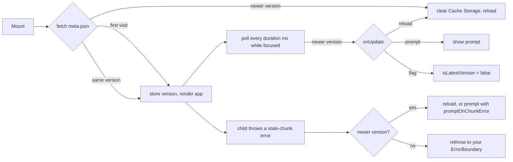

# react-clear-browser-cache

> Keep open tabs on your latest React build: notice a deploy, clear Cache Storage and reload, or ask the user first.

[](https://www.npmjs.com/package/react-clear-browser-cache)
[](https://www.npmjs.com/package/react-clear-browser-cache)
[](https://github.com/devmaxxx/react-clear-browser-cache/actions/workflows/ci.yml)
[](https://bundlephobia.com/package/react-clear-browser-cache)

[](#license)

Users leave tabs open for days. After you deploy, those tabs still run the old build, and the moment they open a lazy route its chunk is gone from the server: `ChunkLoadError`, a blank screen, a support ticket. This library notices the new build and gets the tab onto it.

**[▶ Try the live demo](https://devmaxxx.github.io/react-clear-browser-cache/)** — deploy a new version in one click and watch an open tab notice it, prompt, clear Cache Storage and reload.

<a href="https://devmaxxx.github.io/react-clear-browser-cache/">
  
</a>

## Features

- **Detects new builds** by polling a tiny `meta.json` that a CLI writes at build time.
- **Recovers from stale-chunk errors** — webpack and Vite chunk failures, native `import()` errors in Chrome, Firefox and Safari, and HTML served in place of a script — and passes every other error on to your own error boundary.
- **Asks or acts:** reload on its own, quietly while the tab is in the background, or show an accessible update prompt (built in, or your own component). A `canReload` guard protects unsaved work.
- **Checks when users return:** a tab that was in the background for a while checks for a new build as soon as it gets focus.
- **Clears Cache Storage** before reloading, so a service worker cannot serve the old build again.
- **`lazyRetry`** for flaky networks: retries a dynamic import before giving up.
- **Small and typed:** React 18 and 19, ESM and CommonJS, TypeScript declarations, no runtime dependencies.

## Contents

- [Install](#install)
- [Quick start](#quick-start)
- [Next.js](#nextjs)
- [How it works](#how-it-works)
- [Update prompt](#update-prompt)
- [API](#api)
- [Recipes](#recipes)
- [Troubleshooting](#troubleshooting)
- [Upgrading from 0.x](#upgrading-from-0x)
- [Contributing](#contributing)
- [License](#license)

## Install

```bash
npm install react-clear-browser-cache
# or
pnpm add react-clear-browser-cache
# or
yarn add react-clear-browser-cache
```

Requires React 18 or newer. The `generate-build-meta` CLI needs Node.js 18.3 or newer.

## Quick start

**1. Write a build version on every build.** Add the CLI as a `prebuild` script:

```json
{
  "scripts": {
    "prebuild": "generate-build-meta"
  }
}
```

It writes `{ "version": "<random uuid>" }` to `./public/meta.json`. Use `--destination <path>` for another location, e.g. `generate-build-meta --destination static/meta.json`. It exits with code 1 when it cannot write the file.

**2. Wrap your app** inside your own error boundary:

```tsx
import { createRoot } from 'react-dom/client';
import { ClearBrowserCacheBoundary } from 'react-clear-browser-cache';

import App from './App';
import ErrorBoundary from './ErrorBoundary';
import { UpdateDialog } from './UpdateDialog'; // your prompt, see below

createRoot(document.getElementById('root')!).render(
  <ErrorBoundary>
    <ClearBrowserCacheBoundary
      duration={60_000}
      fallback='Loading…'
      prompt={UpdateDialog}
      promptOnChunkError
    >
      <App />
    </ClearBrowserCacheBoundary>
  </ErrorBoundary>
);
```

**3. Deploy.** Tabs with the old build now see a prompt within a minute, or as soon as a lazy chunk fails to load.

Prefer no prompt at all? `onUpdate='reload'` reloads as soon as a poll finds the new build. Gentler: set `reloadWhenHidden`, and the tab reloads into the new build the moment the user switches away from it. Add `canReload` to hold off while a form has unsaved changes.

```tsx
<ClearBrowserCacheBoundary
  duration={60_000}
  reloadWhenHidden
  canReload={() => !formIsDirty()}
>
```

## Next.js

The package is marked `'use client'`, and it reads `localStorage` only after mount, so it renders on the server and hydrates without a mismatch. Works with the App Router and the Pages Router, webpack or Turbopack; chunk errors from both are recognised.

`generate-build-meta` writes `public/meta.json`, which Next.js serves from the site root, so the `prebuild` script from the quick start works as is. Wrap the app in a client component, because a server component cannot pass functions such as `canReload` to it:

```tsx
// app/providers.tsx
'use client';

import { ClearBrowserCacheBoundary } from 'react-clear-browser-cache';

import { UpdateDialog } from './UpdateDialog';

export function Providers({ children }: { children: React.ReactNode }) {
  return (
    <ClearBrowserCacheBoundary
      duration={60_000}
      prompt={UpdateDialog}
      blocking={false}
    >
      {children}
    </ClearBrowserCacheBoundary>
  );
}
```

```tsx
// app/layout.tsx
import { Providers } from './providers';

export default function RootLayout({
  children
}: {
  children: React.ReactNode;
}) {
  return (
    <html lang='en'>
      <body>
        <Providers>{children}</Providers>
      </body>
    </html>
  );
}
```

- `blocking={false}` keeps the server-rendered page visible while the first check runs. With the default `blocking`, the server sends `fallback` and the page appears only after the check.
- With a `basePath`, pass it in `filename`: `filename='/docs/meta.json'`.
- Errors in a route segment are caught by the nearest `error.tsx` first, so a chunk error inside a page reaches the boundary only when that segment has no `error.tsx`. In one that does, call `clearCacheAndReload` from it for chunk errors.

## How it works



- On mount the boundary shows `fallback` and fetches the meta file; with `blocking={false}` it renders the app at once and checks in the background. A newer build found on mount always reloads straight away.
- Polling runs every `duration` ms, only while the window has focus. A tab that gets focus back after a whole `duration` checks at once. When a check finds a newer build, `onUpdate` decides: `prompt` shows `prompt`, `reload` reloads at once, `flag` only sets `isLatestVersion` to `false` and leaves the reload to you (`clearCacheAndReload`). It defaults to `prompt` when a `prompt` is given and to `flag` otherwise.
- With `reloadWhenHidden`, a tab that knows about a newer build reloads as soon as it goes to the background. It also covers a build found after the tab was hidden, and it reloads even when the user dismissed the prompt for that build. With `duration` set, going to the background also checks once, so a deploy since the last poll is caught too.
- `canReload` is asked before every reload the user did not start: `onUpdate='reload'`, `reloadWhenHidden`, and the check on mount with `blocking={false}`. When it says no, the user is shown `prompt` instead. A reload the user clicks is never blocked.
- When a child throws an error that looks like a stale build, the boundary checks the version: if a new build is out it reloads (or prompts, with `promptOnChunkError`); otherwise the error goes on to your `ErrorBoundary`.
- The meta file is fetched with `cache: 'no-store'`. A file that is missing, has no `version`, or is answered with HTML by an SPA fallback is reported to `debug` and otherwise ignored; the app still renders.
- If storage cannot be read (blocked cookies, private mode), the boundary disables itself and just renders the app.

## Update prompt

The library ships no prompt UI, so the prompt matches your design system. Pass a component; it receives [`UpdatePromptProps`](#updatepromptprops). Declare it at module level: a new function on every render remounts the prompt.

```tsx
import type { UpdatePromptProps } from 'react-clear-browser-cache';

export function UpdateDialog({ reason, reload, dismiss }: UpdatePromptProps) {
  return (
    <Modal open onClose={dismiss}>
      {reason === 'error'
        ? 'Part of the app could not load. Reload to continue.'
        : 'A new version is available.'}
      <Button onClick={dismiss}>Later</Button>
      <Button onClick={reload}>Reload</Button>
    </Modal>
  );
}
```

A complete one to copy is the demo's [`UpdateDialog.tsx`](example/src/UpdateDialog.tsx) with its [CSS](example/src/UpdateDialog.css): a native modal `<dialog>` that focuses **Reload**, dismisses on Escape or **Later**, gives focus back when it closes, and locks its buttons while the page reloads. A dismissed prompt stays hidden until a newer build appears.

A plain element works too (`prompt={<Banner />}`); it reads `clearCacheAndReload` and `dismissUpdate` from `useClearBrowserCache()`.

## API

### `<ClearBrowserCacheBoundary>`

Error boundary and context provider. Place it inside your own error boundary: it only handles stale-build errors.

| Prop                 | Type                             | Default         | Description                                                                                                                           |
| :------------------- | :------------------------------- | :-------------- | :------------------------------------------------------------------------------------------------------------------------------------ |
| `duration`           | `number`                         | —               | Poll interval in ms. Without it the version is checked on mount and on stale-chunk errors only.                                       |
| `onUpdate`           | `'prompt' \| 'reload' \| 'flag'` | see description | What a check that finds a newer build does. Defaults to `prompt` when `prompt` is given, `flag` otherwise.                            |
| `auto`               | `boolean`                        | `false`         | Deprecated: same as `onUpdate='reload'`.                                                                                              |
| `fallback`           | `ReactNode`                      | `null`          | Rendered while the first version check runs, e.g. a preloader.                                                                        |
| `prompt`             | element or component             | —               | Asks the user to reload: your component, or an element. See [Update prompt](#update-prompt).                                          |
| `promptOnChunkError` | `boolean`                        | `false`         | On a stale-build error, show `prompt` over `fallback` instead of reloading at once.                                                   |
| `reloadWhenHidden`   | `boolean`                        | `false`         | Reload into a newer build as soon as the tab goes to the background.                                                                  |
| `canReload`          | `() => boolean`                  | —               | Asked before reloads the user did not start. Return `false` to keep the page.                                                         |
| `blocking`           | `boolean`                        | `true`          | Show `fallback` until the first check answers. `false` renders the app at once.                                                       |
| `filename`           | `string`                         | `'meta.json'`   | Meta file to fetch. A bare name is fetched from the site root; a path starting with `/`, `./` or `../`, or a full URL, is used as is. |
| `storageKey`         | `string`                         | `'APP_VERSION'` | Key the current version is stored under.                                                                                              |
| `storage`            | `{ get(key), set(key, value) }`  | `localStorage`  | Where the version is kept, e.g. [store](https://www.npmjs.com/package/store).                                                         |
| `errorCheckers`      | `((error) => boolean)[]`         | `[]`            | Extra checks for stale-build errors, added to the defaults. See [`createErrorChecker`](#createerrorcheckername-pattern).              |
| `debug`              | `(params) => void`               | —               | Receives state changes and errors, for logging.                                                                                       |

### `useClearBrowserCache()` and `<ClearBrowserCache>`

Read the boundary's state from any child, by hook or by render prop:

```tsx
import {
  ClearBrowserCache,
  useClearBrowserCache
} from 'react-clear-browser-cache';

function VersionBadge() {
  const { isLatestVersion, clearCacheAndReload } = useClearBrowserCache();
  return isLatestVersion ? null : (
    <button onClick={clearCacheAndReload}>Update</button>
  );
}

<ClearBrowserCache>
  {({ latestVersion }) => <small>{latestVersion}</small>}
</ClearBrowserCache>;
```

| Field                 | Type                  | Description                                                                 |
| :-------------------- | :-------------------- | :-------------------------------------------------------------------------- |
| `loading`             | `boolean`             | A version check is running.                                                 |
| `isLatestVersion`     | `boolean`             | The running build is the latest one.                                        |
| `latestVersion`       | `string`              | Version from the most recent meta file.                                     |
| `disabled`            | `boolean`             | Storage failed, so the boundary stopped checking and only renders children. |
| `clearCacheAndReload` | `() => Promise<void>` | Clear Cache Storage, store the latest version and reload.                   |
| `dismissUpdate`       | `() => void`          | Hide the update prompt until a newer build is found.                        |

### `UpdatePromptProps`

| Prop            | Type                  | Description                                                                                         |
| :-------------- | :-------------------- | :-------------------------------------------------------------------------------------------------- |
| `latestVersion` | `string`              | The new build's version.                                                                            |
| `reason`        | `'poll' \| 'error'`   | `'error'` when part of the app failed to load; the boundary shows `fallback` behind the prompt.     |
| `reload`        | `() => Promise<void>` | Clear Cache Storage and reload the page.                                                            |
| `dismiss`       | `() => void`          | Hide until a newer build is found. For `reason: 'error'` the error goes on to your `ErrorBoundary`. |

### `lazyRetry(fn, attempts = 2, interval = 1000)`

Calls `fn` up to `attempts` times in all, `interval` ms apart, until it resolves; then rejects with the last error.

```tsx
import { lazy } from 'react';
import { lazyRetry } from 'react-clear-browser-cache';

const Settings = lazy(() => lazyRetry(() => import('./Settings'), 2, 1000));
```

### `createErrorChecker(name, pattern)`

Builds an error checker that matches an error's `name` and a `RegExp` on its message:

```tsx
import { createErrorChecker } from 'react-clear-browser-cache';

const errorCheckers = [
  createErrorChecker('Error', /Failed to load module script/)
];
```

Recognised out of the box: webpack `ChunkLoadError` and CSS chunk errors, Vite CSS preload errors, native `import()` failures in Chrome, Firefox and Safari, and `SyntaxError: Unexpected token '<'`.

## Recipes

**App under a sub-path (Vite `base`, GitHub Pages).** Point `filename` at the base URL:

```tsx
<ClearBrowserCacheBoundary filename={`${import.meta.env.BASE_URL}meta.json`}>
```

**Version from your CI instead of a random UUID.** Any JSON with a `version` string works, e.g. `echo "{\"version\":\"$GITHUB_SHA\"}" > public/meta.json`.

**Reload on the next route change.** A route change replaces the screen anyway, so it is a quiet moment to switch builds. `clearCacheAndReload` does not ask `canReload`, so check your own guard here:

```tsx
function ReloadOnNavigate() {
  const { isLatestVersion, clearCacheAndReload } = useClearBrowserCache();
  const { pathname } = useLocation(); // react-router
  const previous = useRef(pathname);

  useEffect(() => {
    // Only a real route change counts, not the build turning stale.
    if (pathname !== previous.current && !isLatestVersion && !formIsDirty()) {
      clearCacheAndReload();
    }
    previous.current = pathname;
  }, [pathname, isLatestVersion, clearCacheAndReload]);

  return null;
}
```

**Show the update somewhere other than a dialog.** Leave `prompt` out and render a banner from `isLatestVersion` with the hook.

## Troubleshooting

<details>
<summary>The app never notices a new build</summary>

Open `meta.json` in the browser. It must be the JSON file, not your `index.html`: an SPA fallback that rewrites unknown paths to `index.html` hides a missing file (`debug` reports it). Check that the `prebuild` script ran in CI, and that `duration` is set if you expect polling.

</details>

<details>
<summary>It reloads, but the old build comes back</summary>

Something in front of the browser cached the HTML. Serve `index.html` and `meta.json` with `Cache-Control: no-cache`; hashed assets can stay immutable.

</details>

<details>
<summary>A chunk error still reaches my error boundary</summary>

That happens when the build has not changed — the boundary only recovers when a newer version is out. If your bundler words the error differently, add a checker with `createErrorChecker`.

</details>

## Upgrading from 0.x

Code written for 0.2 keeps working: the props, `useClearBrowserCache`, `<ClearBrowserCache>`, `createErrorChecker`, `lazyRetry` and the `generate-build-meta` CLI are unchanged, and `auto` still reloads (prefer `onUpdate='reload'`). What changed:

- **React 18 or newer** is required (`peerDependencies`). React 16 and 17 users stay on 0.2.
- **Package entry points** go through `exports` (ESM `.mjs`, CommonJS `.cjs`, types for both). Deep imports such as `react-clear-browser-cache/dist/index.js` no longer resolve; import from the package name.
- **The stored version is saved only when the cache is actually cleared**, so `isLatestVersion` stays `false` until the user reloads through `clearCacheAndReload`. 0.2 saved it on every check and could report a stale tab as current.
- **`lazyRetry(fn, 0)`** makes one attempt; 0.2 retried forever.
- **`debug`** receives `error` typed as `unknown` (anything can be thrown) and always receives `state`.
- **`storage`** is typed as `{ get, set }`; the `@ts-ignore` the old `Storage` type needed can go.
- **Server rendering**: storage is read after mount, so the first render shows `fallback` (or the app with `blocking={false}`) on the server and the client alike.

See [CHANGELOG.md](CHANGELOG.md) for everything new.

## Contributing

Issues and pull requests are welcome. Use Node.js 24 (`.nvmrc`) and pnpm:

```bash
pnpm install
pnpm test          # lint, typecheck, unit tests, build, e2e
pnpm test:unit     # Vitest
pnpm test:e2e      # Playwright against the example app in Chromium, Firefox and WebKit
pnpm demo:dev      # the GitHub Pages demo, with deploys simulated in the browser
```

The demo is the example app built with `VITE_DEMO=1`. GitHub Pages serves static files only, so a fetch shim answers `meta.json` with a version kept in localStorage; the version check, cache clearing and reload are the library's own. `.github/workflows/pages.yml` publishes it on every push to `master`.

### Releasing

Bump `version` in `package.json`, add the `CHANGELOG.md` entry, merge, then publish a GitHub release tagged `v<version>`. `.github/workflows/release.yml` checks, builds and publishes it to npm with provenance through Trusted Publishing.

## License

[MIT](LICENSE) © Maksym Synenko
